# Hazard-Warning & Intent-Projection Controller for Autonomous Forklifts

**A distributed, three-node STM32 + CAN electrical control platform that links a 2D LiDAR's field status to a motorised warning gimbal and a front-mounted direction projector, so pedestrians can see where an autonomous forklift detects a hazard and where it intends to go.**


---

## Contents

- [Overview](#overview)
- [Highlights](#highlights)
- [System architecture](#system-architecture)
- [Two implementations: 24 V prototype and 48 V concept](#two-implementations-24-v-prototype-and-48-v-concept)
- [Hardware design](#hardware-design)
- [Designing for a noisy vehicle environment](#designing-for-a-noisy-vehicle-environment)
- [Prototypes](#prototypes)
- [Test results](#test-results)
- [48 V design analysis](#48-v-design-analysis)
- [Lessons learned](#lessons-learned)
- [Limitations and roadmap](#limitations-and-roadmap)
- [Repository structure](#repository-structure)
- [Getting started](#getting-started)
- [Bill of materials](#bill-of-materials)
- [Safety notice](#safety-notice)
- [Datasheets and references](#datasheets-and-references)

---

## Overview

Autonomous forklifts share floor space with people, but the hazards they detect and the moves they are about to make are usually invisible to anyone nearby. A human driver signals intent with gaze and gesture; a driverless truck does not. Projecting warnings onto the floor puts the message exactly where the hazard is, and pedestrians don't need any device of their own to see it.

This repository contains the **electrical control platform** for such a warning system. The platform has three cooperating controllers:

| Controller | Role |
|---|---|
| **Main LiDAR interface controller** | Selects the LiDAR's monitoring-field set, reads the field-status outputs, hosts the inertial sensor and sends conditions/commands over CAN |
| **Gimbal controller** | Drives a stepper and a servo to aim the visual hazard warning, and reads shaft angle from a magnetic encoder |
| **Front-mounted controller** | Drives the stepper channels of the projector mechanism that shows the vehicle's intended direction, with encoder feedback |

The work answers one question: *what reliable electrical hardware architecture can support power distribution, actuator control and inter-module communication for a pedestrian-safety system on autonomous warehouse vehicles?*

> **Scope:** component selection, power distribution, LiDAR signal interfacing, motor-driver circuits, encoder feedback, IMU provision, CAN communication, schematic capture, PCB layout and hardware testing. Perception algorithms, mechanical and optical design, and the application firmware are outside the scope of this repository. The firmware included here exists only to exercise the hardware.

## Highlights

- **Three-node distributed architecture.** Each node generates its own time-critical signals (STEP/DIR, servo PWM, ADC sampling) locally, and only commands and status travel on the shared CAN bus.
- **Two hardware implementations.** Working **24 V prototypes** were built on STM32 NUCLEO-H755ZI-Q boards. **48 V concept PCBs** (4- and 6-layer) were designed in Altium Designer around standalone STM32C552 MCUs.
- **Combined operation demonstrated.** CAN, ADC acquisition, two steppers and a servo ran together, drawing **19.4 W** from the 24 V supply.
- **Actuation under load.** Both the gimbal and the front-mounted mechanisms lifted a **0.75 kg** test load with a **1.5 A** driver current limit.
- **Industrial-level LiDAR interface.** A **3.3 V GPIO command produced a 12.02 V** field-select output through a protected quad line driver.
- **CAN verified.** A five-byte frame was received at **250 kbit/s**, and the link stayed up while motor drivers and buck converters were switching.
- **Design analysis before fabrication.** The analysis caught a regulator **minimum on-time violation** on the direct 48 V→3.3 V stage, an **optocoupler resistor** that fails at 12 V, and a **shared motor feed** that limits simultaneous channels.

---

## System architecture

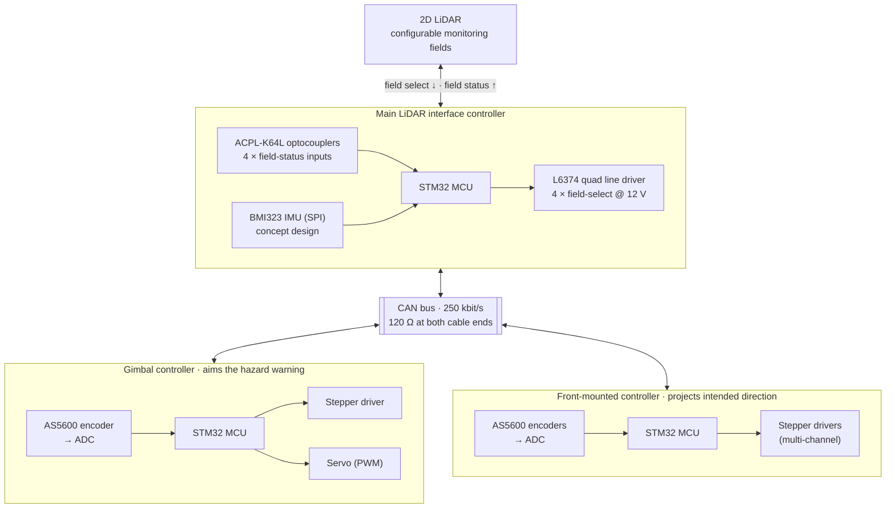

**Design principle:** the architecture keeps time-critical signals local and puts only information on the bus. The main controller reads LiDAR field status and sends the relevant condition or command over CAN. Each actuator controller generates its own STEP, DIR and servo signals and samples its own encoders, so bus latency never disturbs motor timing. This also allowed every interface to be tested on its own before integration.

<details>
<summary><b>Detailed block diagram, CAN topology and 48 V power tree</b></summary>
<br>

<p align="center">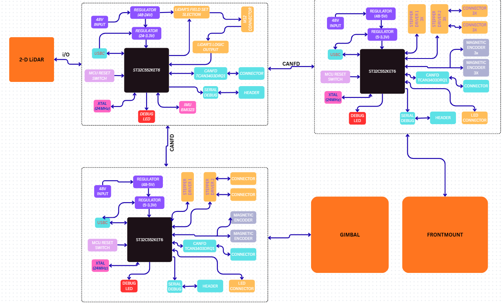</p>
<p align="center"><sub>Concept block diagram of the three controller modules and their CAN FD interconnection</sub></p>

<p align="center">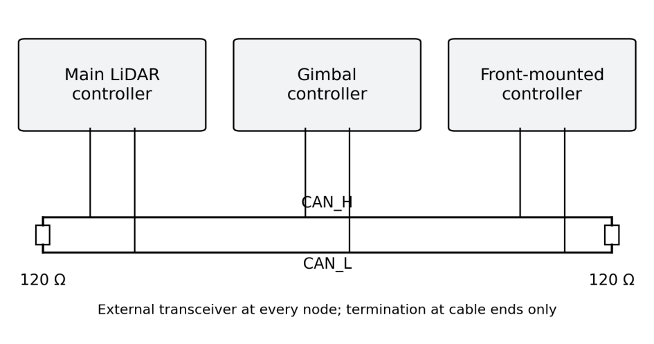</p>
<p align="center"><sub>Three-node CAN topology: a transceiver at every node, 120 Ω termination at the two cable ends only</sub></p>

<p align="center">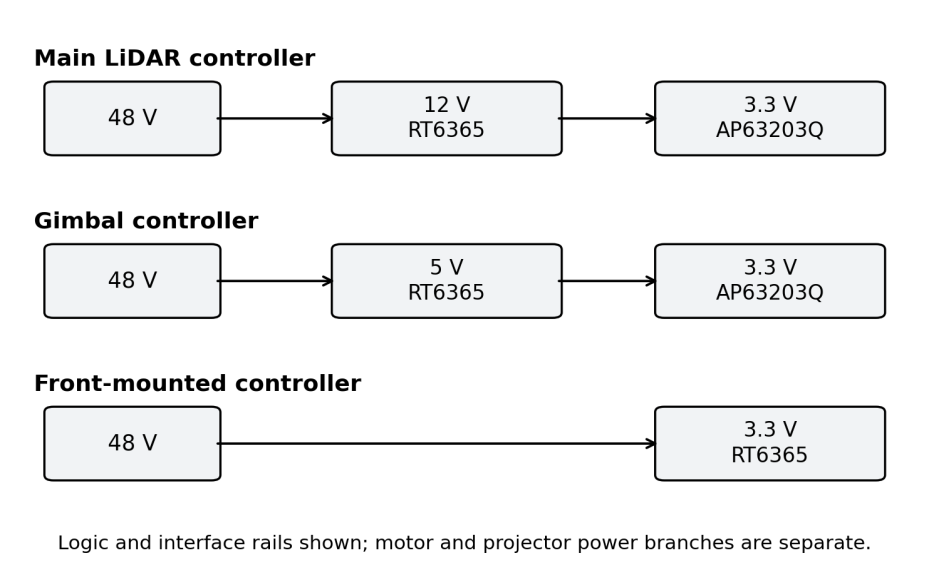</p>
<p align="center"><sub>48 V concept power-conversion paths for the logic and interface rails (motor and projector supplies are routed separately)</sub></p>

</details>

### Concept controller allocation

| Controller | MCU (package) | Channels | PCB layers | Power path |
|---|---|---|---|---|
| Main LiDAR | STM32C552KET6 (LQFP32) | 4 field-select outputs, 4 status inputs, CAN, IMU | 4 | 48 V → 12 V (RT6365) → 3.3 V (AP63203Q) |
| Gimbal | STM32C552RET6 (LQFP64) | 1 × DRV8462 stepper, servo, encoder, CAN | 4 | 48 V → 5 V (RT6365) → 3.3 V (AP63203Q) |
| Front-mounted | STM32C552RET6 (LQFP64) | 2 × DRV8462 in the current layout (6 required by the mechanism), encoders, CAN | 6 | 48 V → 3.3 V direct (RT6365) |

---

## Two implementations: 24 V prototype and 48 V concept

The project produced two parallel implementations. All measured results apply to the 24 V prototypes. The 48 V boards are assessed by design analysis only.

| Design element | Physical prototypes | Concept PCBs |
|---|---|---|
| Nominal input | 24 V | 48 V |
| Controller | NUCLEO-H755ZI-Q development boards | Standalone STM32C552 (LQFP32 / LQFP64) |
| Stepper driver | DRV8825 carrier modules | DRV8462DDW circuits |
| Low-voltage conversion | DFR1015 buck modules | RT6365 and AP63203Q circuits |
| Construction | Soldered perforated boards with SOIC-to-DIP adapters | 4- and 6-layer layouts in Altium Designer |
| Evidence | Assemblies, diagnostic output, supply readings, functional demos | Schematics, layouts and design calculations (not fabricated) |

The parts could not simply carry over between the two. For example, the DRV8825 is rated for 8.2–45 V and cannot run from 48 V, which is why the concept boards use the 4.5–65 V DRV8462.

---

## Hardware design

### Microcontrollers
- **Concept:** STM32C552 (Arm Cortex-M33, up to 144 MHz, up to 512 KB flash, 128 KB SRAM) with an FDCAN controller, timers, ADCs and serial interfaces. Each MCU circuit includes decoupling, reset, a 24 MHz crystal and SWD programming access.
- **Prototype:** NUCLEO-H755ZI-Q, which provides accessible headers and on-board ST-LINK debugging. The H755 and C552 are not pin-compatible, so the peripheral configuration has to be *ported* to the concept boards rather than copied.

### Stepper-motor drivers
- **Prototype: DRV8825.** STEP/DIR interface, 1/32 microstepping. The full-scale chopping current is set by VREF and the sense resistor:

  ```math
  I_{FS} = \frac{V_{REF}}{5\,R_{SENSE}} = \frac{0.75\ \text{V}}{5 \times 0.10\ \Omega} = 1.5\ \text{A}\quad(\approx 1.06\ \text{A RMS})
  ```
- **Concept: DRV8462DDW.** 4.5–65 V motor supply, 3.3 V logic, integrated current sensing and diagnostics.
- With 200-step motors at 1/32 microstepping, one revolution takes 6,400 pulses, so 60 rpm needs a 6.4 kHz step rate. That is far below the DRV8825's 250 kHz limit (≈2,340 rpm).

### CAN interface
- **TCAN3403-Q1** CAN FD transceiver at every node (3.3 V VCC and VIO, ±58 V bus-fault standoff), with **ESDCAN03-2BWY** TVS protection on the bus lines.
- Twisted CAN_H/CAN_L pair with a common reference, and **120 Ω termination at the two physical cable ends only**. With power removed, the bus should measure **60 Ω** between CAN_H and CAN_L, which gives a quick wiring check.

### Power conversion
A linear regulator from 48 V to 3.3 V would be about 6.9 % efficient (≈44.7 W dissipated at 1 A), so buck conversion is used throughout.
- **RT6365** (4.5–60 V, 0.8 V reference, 100 kHz–2.5 MHz) handles the high-input stages. Its output is set by a feedback divider with a fixed 9.1 kΩ resistor plus a 0–2 kΩ trim pot:

  ```math
  V_{OUT} = 0.8\ \text{V}\left(1 + \frac{R_{TOP}}{R_{BOT}}\right)
  ```

  | Rail | R<sub>TOP</sub> | Trim setting | Adjustment range |
  |---|---|---|---|
  | Main 12 V | 140 kΩ | 0.900 kΩ | 10.89–13.11 V |
  | Gimbal 5 V | 52.3 kΩ | 0.862 kΩ | 4.57–5.40 V |
  | Front-mounted 3.3 V | 31.6 kΩ | 1.012 kΩ | 3.08–3.58 V |

- **AP63203Q** fixed 3.3 V synchronous regulators (3.8–32 V input) sit after the 12 V or 5 V intermediate rail on the main and gimbal boards.
- **Prototype:** DFR1015 selectable-output buck modules (7.5–30 V in; 3.3 / 5 / 9 / 12 V out), one per rail.
- Motor and projector supplies are routed separately from the logic rails.

### Encoder feedback
- **AS5600** contactless magnetic encoders, read through their **ratiometric analogue output** on individual STM32 ADC channels. Every AS5600 has the same fixed I²C address (0x36), so several sensors can't share one bus without a multiplexer.
- Resolution: 360° / 4096 = **0.088° per code** (full-range output, 12-bit ADC).
- Converting a code to a mechanism angle uses a two-point calibration:

  ```math
  \theta = \theta_1 + \frac{(N - N_1)(\theta_2 - \theta_1)}{N_2 - N_1}
  ```

### LiDAR field interface
- **Field selection:** an **L6374** quad industrial line driver (10.8–35 V, push-pull, ~100 mA per channel, built-in protection and diagnostics) runs from a dedicated 12 V branch. The MCU only selects the state, and the outputs never switch 48 V onto a scanner input. Four lines give 16 binary codes (S1 = LSB). The scanner configuration decides which codes map to valid field sets.
- **Field status:** **ACPL-K64L** dual digital optocouplers condition the returning signals for the 3.3 V domain. The output is LOW when the LED is on, so firmware inverts the logic. The circuit shares a common ground, so full galvanic isolation is not claimed.

### Inertial sensor
- **BMI323** six-axis IMU on the main controller over SPI with an interrupt line. This is a design provision for future vehicle-motion assessment.

### PCB design
- Main LiDAR and gimbal boards use **4 layers**. The front-mounted board uses **6 layers** to fit its extra driver and encoder routing.
- Continuous reference planes under signal routes, with circuit groups separated by placement rather than split planes, and return vias at every layer transition.
- Compact switching loops for drivers and buck converters, analogue encoder routes kept away from them, and CAN_H/CAN_L routed as a pair.
- Conductors are sized with IPC-2221B: $I = k\,\Delta T^{0.44} A^{0.725}$ ($k = 0.048$ external, $0.024$ internal).

<details>
<summary><b>PCB layouts</b></summary>
<br>
<p align="center">
  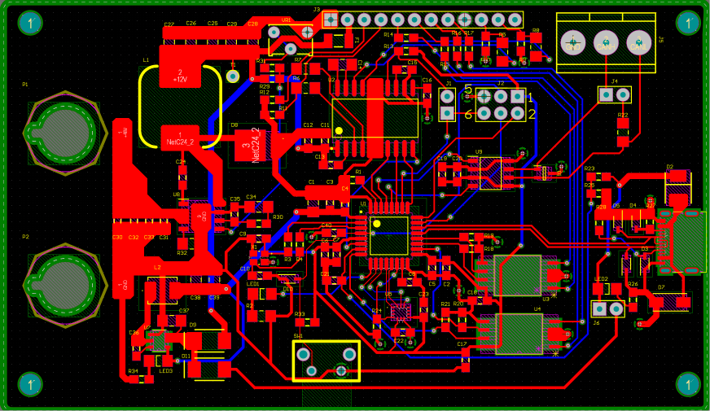
  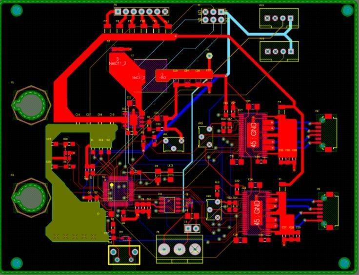
</p>
<p align="center">
  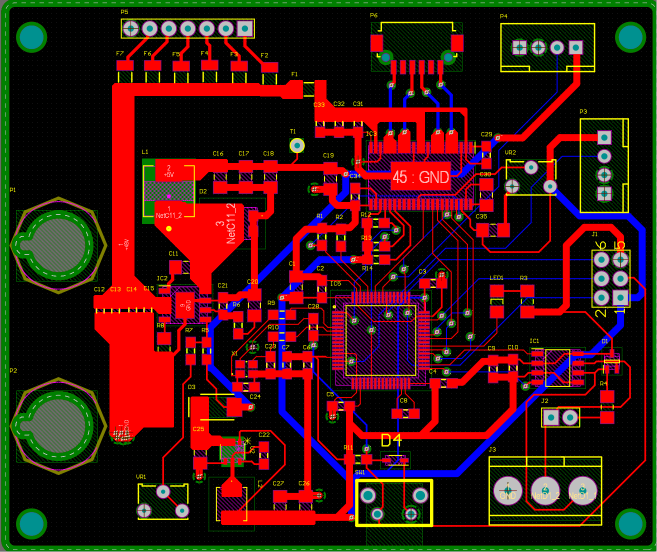
</p>
<p align="center"><sub>Main LiDAR controller (4-layer) · gimbal controller (4-layer) · front-mounted controller, two-channel stage (6-layer)</sub></p>
</details>

---

## Designing for a noisy vehicle environment

Reliability was designed into every interface rather than left to testing alone.

| Threat | Design measure | Where |
|---|---|---|
| Noise coupling into the inter-module link | Differential CAN on a twisted pair with a common reference; 120 Ω at the two cable ends only | All nodes |
| Corrupted or lost messages | CAN CRC, acknowledgement, error signalling, automatic retransmission and fault confinement | FDCAN peripheral |
| Bus wiring faults and transients | TCAN3403-Q1 with ±58 V bus-fault standoff; TVS arrays on the bus lines | All nodes |
| Industrial-level LiDAR signals entering 3.3 V logic | Optocoupled status inputs with current-limiting resistors | Main controller |
| Overload on LiDAR selection lines | Protected L6374 line driver on a separate 12 V branch | Main controller |
| Driver overcurrent, overheating, brown-out | DRV8825 protection with 1.5 A limit; DRV8462 diagnostics on concept boards | Actuator controllers |
| Supply overload | 5 A fuses; shared motor feed limited to four energised channels | Prototypes |
| Regulator heating and droop | Buck conversion; stages checked against minimum on-time at the highest input | All boards |
| Motor switching noise reaching logic | Separate motor/logic rails, local decoupling, compact loops, continuous planes | Concept PCBs |
| Bus delays disturbing actuator timing | Each node generates its own STEP/DIR/PWM; only commands and status use the bus | All nodes |

---

## Prototypes

<p align="center">
  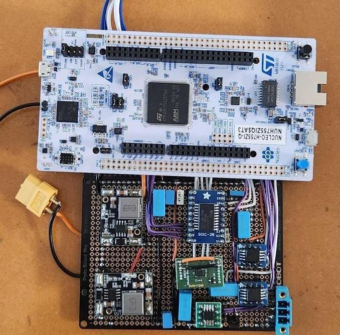
  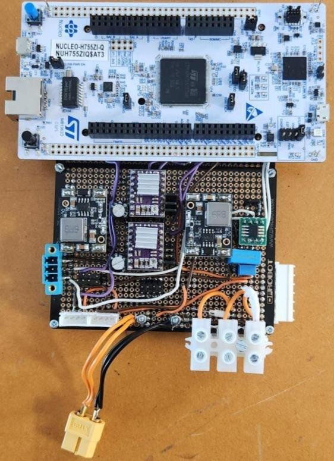
  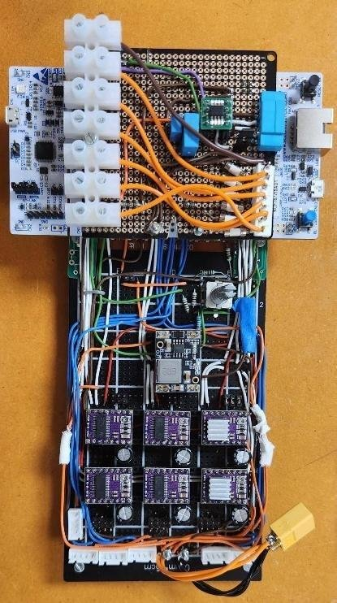
  <br>
  <sub>Main LiDAR interface controller · gimbal controller · front-mounted controller (eight DRV8825 modules)</sub>
</p>

| Prototype | Contents |
|---|---|
| Main LiDAR | NUCLEO-H755ZI-Q, two DFR1015 converters (3.3 V and 12 V), L6374 line driver, two dual optocouplers, CAN transceiver |
| Gimbal | NUCLEO-H755ZI-Q, two DRV8825 modules, 3.3 V and 5 V converters, CAN transceiver, encoder/servo/projector connections |
| Front-mounted | NUCLEO-H755ZI-Q, eight DRV8825 modules, 3.3 V converter, CAN transceiver, motor/encoder/projector connections |

The modular construction paid off during testing. Individual modules could be measured and swapped without rebuilding a controller, and that is how the driver fault described below was found.

---

## Test results

Each subsystem was verified on its own before combined operation, and every function was judged against a predefined pass criterion.

| Function | Test | Result | Status |
|---|---|---|---|
| Power | All connected functions energised together from 24 V | 24.2 V × 0.80 A = **19.4 W** on the principal output | ✅ Pass |
| Stepper + load | Lift a 0.75 kg test load | Gimbal lifted it; front-mounted lifted it after a faulty DRV8825 module was replaced | ✅ Pass |
| Servo | PWM command during combined operation | Servo moved on command | ✅ Pass |
| Encoder | Acquire AS5600 outputs on PA3 / PC0 | Valid 12-bit codes on both channels; ≈4-code scatter | ✅ Pass (acquisition) |
| LiDAR output | Set GPIO HIGH, measure L6374 output | **12.02 V** from a 3.3 V command | ✅ Pass |
| LiDAR input | Known field condition → MCU state | Not verified with a scanner | ⏳ Pending |
| CAN | Transmit a known frame to a second node | ID **0x65D**, 5 bytes `48 65 6C 6C 6F` ("Hello") at **250 kbit/s**; link held during combined operation | ✅ Pass |
| IMU | — | Design provision only | ⏳ Pending |

<p align="center">
  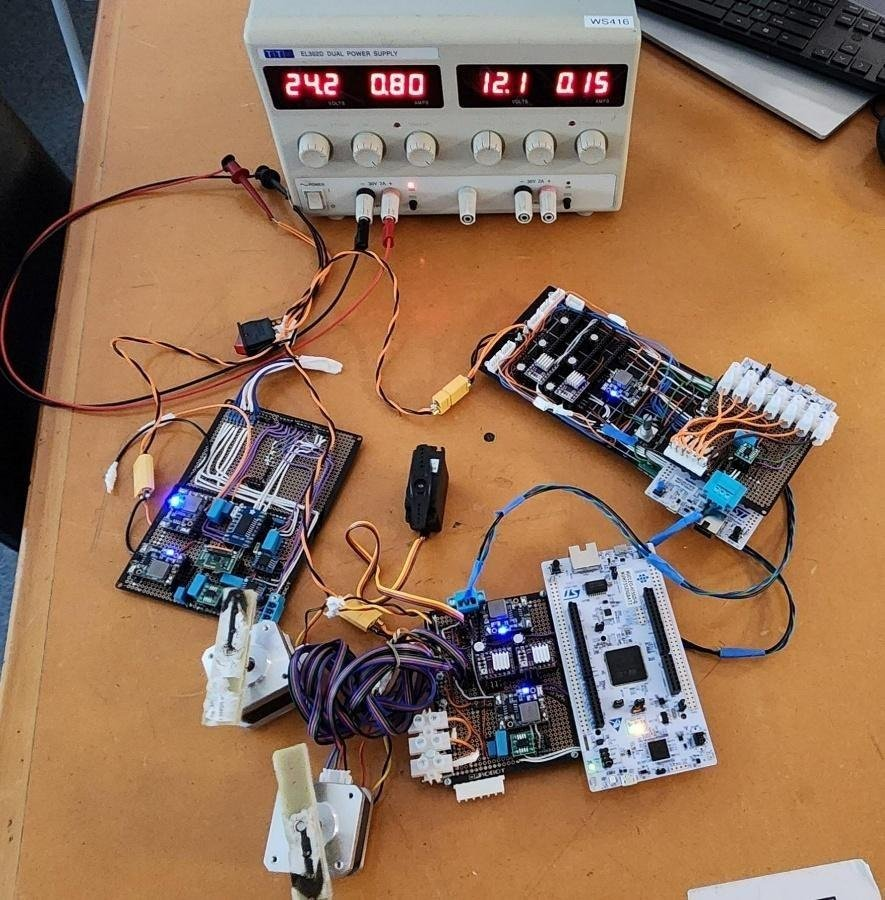
  <br>
  <sub>Combined operation: CAN, ADC acquisition, two steppers and a servo running together from the 24 V supply</sub>
</p>

<p align="center">
  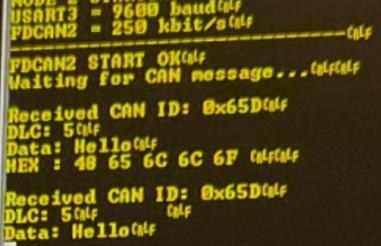
  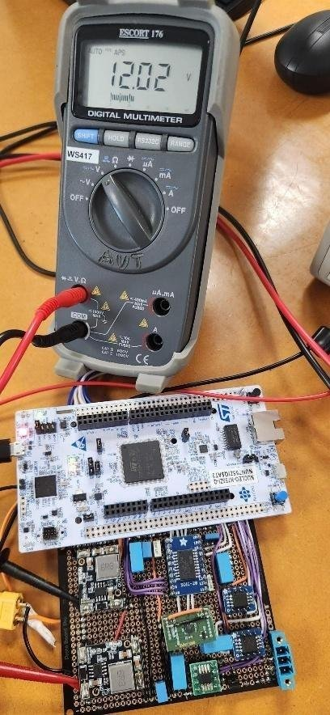
  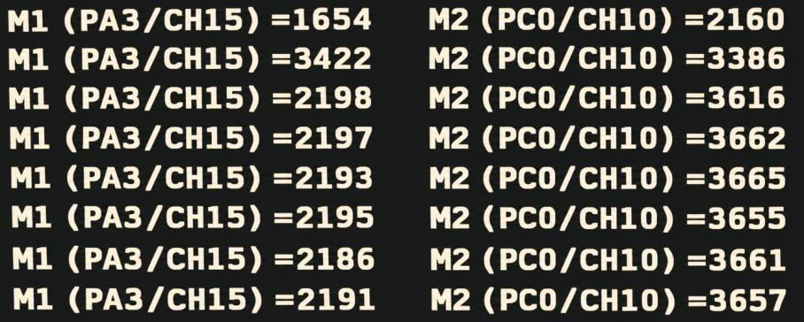
  <br>
  <sub>CAN frame received at 250 kbit/s · 12.02 V field-select output from a 3.3 V GPIO · raw AS5600 ADC codes on PA3 and PC0</sub>
</p>

<p align="center">
  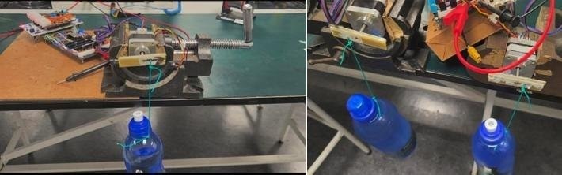
  <br>
  <sub>Gimbal and front-mounted load tests with the 0.75 kg test load</sub>
</p>

### Recorded supply readings

| Operating point | Voltage (V) | Current (A) | Power (W, calc.) |
|---|---|---|---|
| Combined test, principal output | 24.2 | 0.80 | 19.4 |
| Front-mounted, original DRV8825 (stationary, failed to lift) | 24.64 | 0.162 | 3.99 |
| Front-mounted, replacement DRV8825 (lifted 0.75 kg) | 24.43 | 0.338 | 8.26 |
| Two loaded channels | 24.14 | 0.662 | 16.0 |

### Encoder resolution vs. microstep size

| Quantity | Angle |
|---|---|
| AS5600, full-range analogue, 12-bit ADC | 0.088° |
| Recorded scatter (1σ, final five samples) | ≈ 0.36° |
| 1/32 microstep of a 1.8° motor (setting used) | 0.056° |

One encoder code spans about 1.6 microsteps, so feedback resolves movements of a few microsteps. Averaging 16 samples would bring the scatter down to about 0.09°.

---

## 48 V design analysis

The 48 V boards were not fabricated, so their design equations were checked against an **assumed 57.6 V maximum** (a 24-cell lead-acid traction battery charging at 2.40 V/cell).

### Buck regulator minimum on-time (RT6365, t<sub>on,min</sub> = 135 ns)

| Rail | Duty at 48 V | t<sub>on</sub> @ 500 kHz, 48 V | t<sub>on</sub> @ 500 kHz, 57.6 V | Max f<sub>SW</sub> at 57.6 V |
|---|---|---|---|---|
| 12 V (main) | 25.0 % | 500 ns | 417 ns | 1,543 kHz |
| 5 V (gimbal) | 10.4 % | 208 ns | 174 ns | 643 kHz |
| **3.3 V (front-mounted, direct)** | 6.9 % | 137.5 ns | **114.6 ns ⚠️** | **424 kHz** |

⚠️ At 500 kHz the direct 48 V → 3.3 V stage would skip pulses at high battery voltage. It needs to switch at ≤ ~420 kHz (preferably 300–350 kHz) or use an intermediate rail like the other two boards.

### CAN bus capacity (Classical CAN, 11-bit ID, 250 kbit/s)

| Data bytes | Worst-case bits | Worst-case time | Max frames/s |
|---|---|---|---|
| 0 | 55 | 220 µs | 4,545 |
| 5 | 105 | 420 µs | 2,381 |
| 8 | 135 | 540 µs | 1,852 |

If all three nodes sent a 5-byte frame every 10 ms, bus utilisation would be **12.6 %**. The open question is reliability under vehicle noise, not bandwidth.

### Shared motor feed

The front-mounted DRV8825 modules share a 24 V feed wired with **1.8 A-rated** conductor. At ≈0.33 A per loaded channel:

| Energised channels | Current | Utilisation of 1.8 A |
|---|---|---|
| 2 (recorded) | 0.66 A | 37 % |
| 4 (calc.) | 1.32 A | 73 % |
| 5 (calc.) | 1.65 A | 92 % |
| 6 (calc.) | 1.98 A | **110 % ❌** |

With a 20 % design margin, the feed supports **four simultaneous channels**. Running all six needs a feed rated for **≥ 2.5 A**.

### Track sizing (1 oz copper, 10 °C rise)

| Width | Outer-layer capacity | Inner-layer capacity |
|---|---|---|
| 0.25 mm | 0.88 A | 0.44 A |
| 0.5 mm | 1.45 A | 0.72 A |
| 1.0 mm | 2.39 A | 1.20 A |
| 2.0 mm | 3.95 A | 1.98 A |

2 A paths need **≥ 0.78 mm** on outer layers or **≥ 2.0 mm** on inner layers.

### Optocoupler series resistor

| Series resistor | I<sub>F</sub> @ 12 V | I<sub>F</sub> @ 24 V | Within 1.6–6 mA? |
|---|---|---|---|
| 10 kΩ (as drawn) | 1.07 mA | 2.27 mA | 24 V only |
| **4.7 kΩ (recommended)** | 2.28 mA | 4.83 mA | ✅ Both levels |

Allowing for the full forward-voltage range, the valid window for both signal levels is 3.84–6.44 kΩ.

---

## Lessons learned

- **Check the driver before blaming the motor.** The front-mounted mechanism couldn't lift the load until its DRV8825 module was swapped, even though both modules were set to the same 1.5 A limit. Input current roughly doubled (×2.09) at a slightly *lower* supply voltage. Re-measuring VREF on the failed module would have separated a drifted setting from a damaged driver.
- **Size the power path for the total, not the parts.** Adequate individual driver ratings can't make up for an undersized shared conductor. Here, the supply wiring set the simultaneous channel count, not the number of MCU outputs or driver modules.
- **Define numerical acceptance criteria and a recording template up front.** Accuracy and reliability can't be assessed from photos of single operating points.
- **Prefer a module-carrier PCB over perfboard** for circuits this dense. Mounting ready-made modules on a custom interconnect board reduces wiring errors and solder bridges, and speeds up debugging.

---

## Limitations and roadmap

**Current limitations**
- Each test was performed once and recorded from instrument displays, with no repeated trials, uncertainty estimates or time-resolved records.
- Encoder readings were not paired with reference angles, so accuracy is unknown and the position loop was not closed.
- The LiDAR status-input path and the IMU were not tested.
- CAN testing used one frame type without sequence numbers, timestamps or error counters.
- The 48 V boards were not fabricated. ERC/DRC and pin-multiplexing records were not exported, and the front-mounted layout covers two of six channels.
- The effect of the warnings on pedestrian awareness was not evaluated.

**Roadmap**
- [ ] Upgrade the front-mounted motor feed to ≥ 2.5 A, then measure current, voltage drop and temperature with all six channels energised
- [ ] Re-measure VREF on every driver carrier and repeat load tests (≥ 5 runs) with step rate, acceleration and lever arm recorded
- [ ] Calibrate the encoders against reference angles, report error and repeatability, then close the position loop
- [ ] Characterise the LiDAR status inputs with a real scanner and field configuration, and fit the 4.7 kΩ optocoupler resistor
- [ ] Evaluate the BMI323 with defined orientation, sampling and bias handling
- [ ] Log CAN sequence numbers, timestamps and error counters with actuators off and on, and record a full LiDAR-event → actuator-response chain
- [ ] Lower the direct 3.3 V stage switching frequency (or add an intermediate rail), complete the six-channel front-mounted layout, and clear ERC/DRC
- [ ] Obtain the real vehicle supply envelope, then fabricate and commission the 48 V boards rail by rail
- [ ] Test the integrated system on a vehicle and run pedestrian-comprehension studies

---

## Repository structure

```
.
├── README.md
├── hardware/
│   ├── main-lidar-controller/        # Altium Designer project: schematics + 4-layer PCB
│   ├── gimbal-controller/            # Altium Designer project: schematics + 4-layer PCB
│   └── front-mounted-controller/     # Altium Designer project: schematics + 6-layer PCB
├── firmware/
│   └── encoder_adc_diagnostic/       # Two-channel AS5600 ADC test sketch
├── bom/
│   └── prototype_bom.csv             # Prototype component order (30 line items)
└── docs/
    └── images/                       # Figures used in this README
```

---

## Getting started

### Hardware files
The schematics and PCB layouts are Altium Designer projects. Open the `.PrjPcb` file in each folder under `hardware/`. The layouts are **concept designs**: confirm the vehicle supply envelope, apply the revisions listed in [48 V design analysis](#48-v-design-analysis), and clear ERC/DRC before sending anything to fabrication.

### Prototype pin map (NUCLEO-H755ZI-Q)

| Signal | Pin | Path |
|---|---|---|
| SELECT_LiDAR1 (S1, LSB) | PG9 | MCU → L6374 → LiDAR |
| SELECT_LiDAR2 (S2) | PD14 | MCU → L6374 → LiDAR |
| SELECT_LiDAR3 (S3) | PD15 | MCU → L6374 → LiDAR |
| SELECT_LiDAR4 (S4) | PB5 | MCU → L6374 → LiDAR |
| LiDAR_OUT1 | PE11 | LiDAR → optocoupler → MCU |
| LiDAR_OUT2 | PG12 | LiDAR → optocoupler → MCU |
| LiDAR_OUT3 | PA8 | LiDAR → optocoupler → MCU |
| LiDAR_OUT4 | PE14 | LiDAR → optocoupler → MCU |
| Encoder M1 (AS5600 OUT) | PA3 | ADC, 12-bit |
| Encoder M2 (AS5600 OUT) | PC0 | ADC, 12-bit |

### Encoder ADC test
1. Install the [Arduino core for STM32](https://github.com/stm32duino/Arduino_Core_STM32) and select the **NUCLEO-H755ZI-Q** board.
2. Wire each AS5600 analogue output to PA3 and PC0, with the sensors powered from the same 3.3 V reference as the ADC.
3. Upload `firmware/encoder_adc_diagnostic/encoder_adc_diagnostic.ino`.
4. Open a serial monitor at **115200 baud** to see raw codes (0–4095) every 100 ms.

### CAN test settings
Receiving node: **FDCAN2 at 250 kbit/s**, with diagnostics printed on **USART3 at 9600 baud**. Before connecting nodes, check that the unpowered bus measures about **60 Ω** between CAN_H and CAN_L.

### Prototype bring-up checklist
- Inspect for polarity errors and solder bridges, and check continuity, all unpowered.
- First power-up with a current-limited supply. Measure each converter output **before** connecting loads.
- Set and verify DRV8825 VREF (0.75 V → 1.5 A) and check it against the motor's rated phase current.
- Give mechanisms clear travel before sending motion commands.

---

## Bill of materials

The full prototype order is in [`bom/prototype_bom.csv`](bom/prototype_bom.csv): 30 line items totalling **$495.74**.

| Category | Cost ($) | Share |
|---|---|---|
| DRV8825 driver modules | 203.28 | 41.0 % |
| LiDAR line drivers and optocouplers | 70.74 | 14.3 % |
| Perforated boards and IC adapters | 51.44 | 10.4 % |
| DFR1015 converter modules | 49.10 | 9.9 % |
| Connectors and terminals | 37.06 | 7.5 % |
| Capacitors, resistors and fuses | 35.42 | 7.1 % |
| BMI323 evaluation board | 29.43 | 5.9 % |
| CAN transceivers, TVS arrays, termination resistors | 19.27 | 3.9 % |

The total is a component procurement cost only. It excludes the Nucleo boards, motors, encoders, projectors, mechanical parts and PCB fabrication.

---

## Safety notice

This is a **research prototype**. The LiDAR field status is used for **warnings only and is not a safety function**. Warning and projection devices supplement physical separation of vehicles and pedestrians; they do not replace it. The hardware has not been assessed against ISO 3691-4 (driverless industrial trucks) or IEC 61496-3 (safety laser scanners), and vehicle installation and functional-safety assessment were outside the scope of this work.

---

## Datasheets and references

**Key components**
- [STM32C552 datasheet](https://www.st.com/resource/en/datasheet/stm32c552ke.pdf) · [NUCLEO-H755ZI-Q user manual (UM2408)](https://www.st.com/resource/en/user_manual/um2408-stm32h7-nucleo144-boards-mb1363-stmicroelectronics.pdf)
- [DRV8825](https://www.ti.com/lit/ds/symlink/drv8825.pdf) · [DRV8462](https://www.ti.com/lit/ds/symlink/drv8462.pdf) stepper drivers
- [TCAN3403-Q1 CAN FD transceiver](https://www.ti.com/lit/gpn/TCAN3403-Q1) · [TI CAN physical layer requirements (SLLA270)](https://www.ti.com/lit/an/slla270/slla270.pdf)
- [RT6365 buck converter](https://www.richtek.com/assets/product_file/RT6365/DS6365-02.pdf) · [AP63203Q buck converter](https://www.diodes.com/datasheet/download/AP63200Q%20AP63201Q%20AP63203Q%20AP63205Q.pdf) · [DFR1015 module](https://www.dfrobot.com/product-2599.html)
- [L6374 quad line driver](https://www.st.com/resource/en/datasheet/l6374.pdf) · [ACPL-K64L optocoupler](https://docs.broadcom.com/doc/AV02-2150EN)
- [AS5600 magnetic encoder](https://www.infineon.com/part/AS5600) · [BMI323 IMU](https://www.bosch-sensortec.com/media/boschsensortec/downloads/product_flyer/bst-bmi323-fl000.pdf)

**Design references**
- B. Hauke, [*Basic calculation of a buck converter's power stage*](https://www.ti.com/lit/pdf/slva477), TI SLVA477
- H. J. Zhang, [*Basic concepts of linear regulator and switching mode power supplies*](https://www.analog.com/en/resources/app-notes/an-140.html), Analog Devices AN-140
- R. I. Davis et al., "Controller Area Network (CAN) schedulability analysis: Refuted, revisited and revised," *Real-Time Systems*, 2007
- L. Zhang et al., "A control system of multiple stepmotors based on STM32 and CAN bus," ISBDAI '20, 2020
- ISO 11898-1/-2 (CAN), IPC-2221B (printed board design), ISO 3691-4, IEC 61496-3

---

## Author

**Mohamed Hanan Mohamed Tahir**

Final-year electrical and electronic engineering project, 2026.
